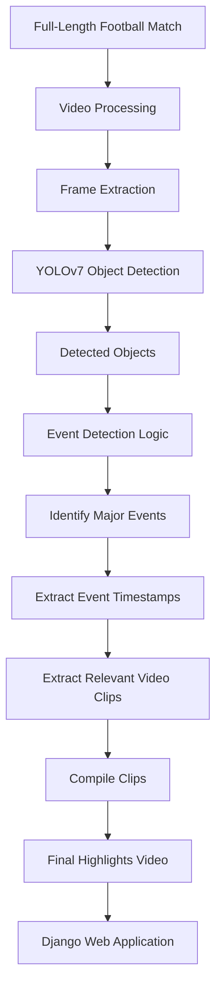

# DeepShot ⚽
### Automated Football Highlights Generation Using Deep Learning & Computer Vision

DeepShot is a computer vision-based application that automatically generates football (soccer) match highlights from full-length match recordings. Using Deep Learning and Computer Vision techniques, the system identifies significant events during a match, extracts the corresponding video segments, and combines them into a single highlights video.

Unlike conventional sports highlight-generation approaches that rely primarily on audio signals, DeepShot focuses on **visual information extracted directly from match footage**. Through object detection and visual analysis, the system identifies important football events without depending on commentary, crowd reactions, or other audio cues.

---

## 📌 Table of Contents

- [Project Overview](#-project-overview)
- [Project Objectives](#-project-objectives)
- [Key Features](#-key-features)
- [Technologies Used](#-technologies-used)
- [System Architecture](#-system-architecture)
- [How It Works](#️-how-it-works)
- [Dataset Preparation](#-dataset-preparation)
- [Deep Learning Model](#-deep-learning-model)
- [Event Detection Methodology](#-event-detection-methodology)
- [Highlight Generation](#-highlight-generation)
- [Web Application](#-web-application)
- [Evaluation and Results](#-evaluation-and-results)
- [Deployment and MLOps](#-deployment-and-mlops)
- [Repository Structure](#-repository-structure)
- [Contributors](#-contributors)
- [Acknowledgements](#-acknowledgements)
- [References](#-references)

---

## 🎯 Project Overview

Watching an entire football match can be time-consuming, particularly for viewers interested in its most significant moments. DeepShot was developed to automate the process of identifying important events and generating a highlights video from a complete match recording.

The system accepts a full-length football match as input and uses Deep Learning and Computer Vision techniques to identify significant events, including:

- Goals
- Red cards
- Yellow cards
- Near misses, where the ball approaches or passes close to the goalpost

Once an event is detected, its timestamp is recorded. The system then extracts the relevant video segment around that timestamp and combines the extracted clips into a single highlights video.

DeepShot brings together object detection, visual event analysis, video processing, and web application development in an end-to-end football highlights generation system.

## 🎯 Project Objectives

The primary objectives of DeepShot were:

1. Accept a full-length football match as input.
2. Apply Deep Learning and Computer Vision techniques to match footage.
3. Detect relevant objects within football match frames.
4. Identify significant events, including goals, cards, and near misses.
5. Record timestamps corresponding to detected events.
6. Extract relevant video clips around identified events.
7. Combine the extracted clips into a single highlights video.
8. Provide a web-based interface for accessing and demonstrating generated highlights.

## ✨ Key Features

| Feature | Description |
|---|---|
| Video-based event detection | Identifies significant football events using visual information |
| Object detection | Uses a YOLO-based deep learning model to detect relevant objects |
| Goal detection | Uses detected objects and their spatial relationships to identify goal events |
| Card detection | Detects red and yellow cards in match footage |
| Near-miss detection | Uses ball and goalpost information to identify near-miss situations |
| Timestamp extraction | Records the timestamps of identified events |
| Automatic clip extraction | Extracts relevant footage around detected events |
| Highlight compilation | Combines individual event clips into one highlights video |
| Web application | Provides an interface for managing and watching generated highlights |

## 🛠 Technologies Used

The project incorporated the following technologies and tools:

| Technology | Purpose |
|---|---|
| Python | Core programming language |
| YOLOv7 | Deep Learning-based object detection |
| Deep Learning | Object detection and visual event analysis |
| Computer Vision | Visual analysis and event-detection logic |
| LabelImg | Manual image annotation and dataset preparation |
| CVAT | Data annotation |
| Kdenlive | Video trimming and preparation |
| Django | Web application development |
| Docker | Application containerization |
| AWS | Cloud hosting and deployment |

## 🏗 System Architecture

DeepShot follows a pipeline-based architecture in which the input match video is processed through several stages before the final highlights video is generated.

The overall workflow consists of:

1. Video Input
2. Video Processing and Frame Extraction
3. Object Detection using YOLOv7
4. Visual Event Detection
5. Timestamp Extraction
6. Video Segment Extraction
7. Highlight Compilation
8. Output through the Web Application

### High-Level Workflow



## ⚙️ How It Works

### 1. Video Input and Processing

The system takes a full-length football match recording as input.

The video is processed and divided into individual frames to facilitate visual analysis. Frame extraction allows the object detection model to examine the match footage and identify relevant objects throughout the video.

### 2. Object Detection

The extracted frames are passed through a YOLO-based object detection model.

The model is trained to identify objects relevant to football events, including:

- Football
- Goalposts
- Red cards
- Yellow cards

The model produces object detections that are subsequently used by the event-detection logic.

### 3. Event Detection

Object detection provides information about the objects present in a frame. DeepShot uses additional logic to interpret the detected objects and their spatial relationships in the context of football events.

For example, the relative positions of the ball and goalpost are considered as part of the logic for identifying goal events.

Similarly, red and yellow card detections are used to identify card-related events, while ball and goalpost information contributes to near-miss detection.

### 4. Timestamp Extraction

Whenever a significant event is identified, the corresponding timestamp is recorded.

These timestamps represent the moments in the original match footage where relevant events occur.

### 5. Video Clip Extraction

After identifying the event timestamps, the system extracts the corresponding video segments.

The implementation was designed to capture footage around the detected event, including approximately 15 seconds before and after the event frame.

This provides relevant match context around each identified event.

### 6. Highlight Compilation

All extracted video segments are combined into a single video.

The resulting highlights video contains the significant events identified throughout the original match. Its final duration depends on the number of events detected.

## 🗂 Dataset Preparation

A major component of the project involved collecting and preparing a custom dataset for object detection.

Football match footage was collected and processed to create a dataset containing the objects required for the project's event-detection pipeline.

Approximately 25 football matches were collected during the initial data collection phase.

### Data Collection

Football match footage was collected from online sources, including:

- YourSoccerDose
- SoccerCatch
- Roboflow Universe

### Data Preparation Pipeline

The dataset preparation process involved:

1. Collecting football match recordings.
2. Trimming and extracting relevant video segments using Kdenlive.
3. Extracting individual frames from the videos.
4. Identifying frames containing relevant objects.
5. Manually annotating images using LabelImg and CVAT.
6. Preparing annotations in YOLO-compatible format.
7. Organizing the dataset for model training.

### Annotation

Images were manually labelled to identify objects relevant to the project's event-detection requirements.

The annotation process included objects such as:

- Footballs
- Goalposts
- Red cards
- Yellow cards

The resulting annotations were prepared for training the object detection model.

## 🧠 Deep Learning Model

DeepShot uses the YOLO (You Only Look Once) family of object detection models, with **YOLOv7** serving as a key model during development.

YOLO is a single-stage object detection approach that predicts object locations and their corresponding classes directly from images.

### Model Development Process

The model development process involved:

1. Preparing the custom annotated dataset.
2. Experimenting with different Machine Learning and Deep Learning models.
3. Evaluating pre-trained models against the project's requirements.
4. Training models using the collected dataset.
5. Testing and validating model predictions.
6. Tuning hyperparameters during model development.
7. Integrating object detection results into the event-detection pipeline.

### Why YOLO?

YOLO was selected because it can identify multiple objects within an image in a single detection pass.

This makes it suitable for analysing football match frames in which multiple relevant objects may appear simultaneously.

## 🔍 Event Detection Methodology

DeepShot focuses on identifying three categories of major football events.

### 1. Goals

Goal detection uses visual information obtained from the object detection model.

The event-detection logic considers the detected football and goalpost, including their relative spatial positions, to identify goal events.

### 2. Red and Yellow Cards

The system uses object detection to identify red and yellow cards within match footage.

The resulting detections are used by the event-detection pipeline to identify card-related events.

### 3. Near Misses

Near misses involve situations where the football approaches or passes close to the goalpost without resulting in a goal.

The system uses detected ball and goalpost information to identify these situations.

These mechanisms combine deep learning predictions with additional computer vision logic to identify significant moments in a football match.

## 🎬 Highlight Generation

Once the event-detection process identifies significant moments, the system uses their timestamps to extract the corresponding video segments.

The highlight-generation process consists of:

1. Receiving timestamps from the event-detection pipeline.
2. Locating the corresponding positions in the original match video.
3. Extracting video segments around the identified events.
4. Including approximately 15 seconds of footage before and after each event frame.
5. Combining the extracted segments into a single highlights video.

The final output is a compiled video containing the identified major events from the original football match.

## 🌐 Web Application

A web-based application was developed using **Django** to demonstrate the functionality of DeepShot.

The application provides an interface for interacting with the system and accessing generated football highlights.

The application workflow includes:

- Administrative sign-in.
- Uploading football match footage.
- Managing generated highlight videos.
- Updating or deleting highlight entries.
- Watching generated highlights.

The Django application serves as the demonstration interface for the underlying Deep Learning and Computer Vision pipeline.

## 📊 Evaluation and Results

The system was evaluated using 55 sample videos.

The evaluation focused on the identification of four event categories:

- Goals
- Near misses
- Red cards
- Yellow cards

The following metrics were used:

- True Positives (TP)
- False Positives (FP)
- False Negatives (FN)
- Precision
- Recall

### Evaluation Metrics

**Precision**

Measures how many of the events detected by the system were correct.

\[
Precision = \frac{TP}{TP+FP}
\]

**Recall**

Measures how many of the actual events were successfully detected by the system.

\[
Recall = \frac{TP}{TP+FN}
\]

### Experimental Results

The following results were recorded during project evaluation:

| Event | True Positives | False Positives | False Negatives | Precision | Recall |
|---|---:|---:|---:|---:|---:|
| Goals | 11 | 2 | 2 | 84.61% | 84.61% |
| Near Misses | 12 | 5 | 1 | 70.58% | 92.30% |
| Red Cards | 5 | 1 | 3 | 83.33% | 62.50% |
| Yellow Cards | 8 | 2 | 3 | 80.00% | 72.72% |

These results provide an evaluation of DeepShot's event-detection performance across the four categories.

## ☁️ Deployment and MLOps

The project also incorporated deployment and basic MLOps practices.

The deployment-related work included:

- Containerizing the application using Docker.
- Preparing the application for deployment.
- Hosting the project on Amazon Web Services (AWS).
- Performing error analysis to assess system performance.

These activities provided practical experience in preparing and deploying a Deep Learning-based software application.

## 📁 Repository Structure

The repository contains Jupyter notebooks used during different stages of experimentation and development.

```text
FYP_DeepShot/
│
├── FYP2.ipynb
│   └── Main project experimentation and development
│
├── RedCardDetection.ipynb
│   └── Red card detection experiments
│
├── VideoToFrames.ipynb
│   └── Video-to-frame extraction experiments
│
├── MovingRenamingFiles.ipynb
│   └── Dataset file organization and management
│
└── README.md
    └── Project documentation
```

## 👨‍💻 Contributors

DeepShot was developed as a Final Year Project at the **National University of Computer and Emerging Sciences (FAST-NUCES), Islamabad, Pakistan**, in 2023.

**Project Team:**

- Shazil Ahmed
- Zohaib Bashir
- Zaafir Rizwan

**Project Supervisors:**

- Dr. Akhtar Jamil
- Dr. Uzair Iqbal

## 🙏 Acknowledgements

We would like to thank our project supervisors for their guidance and support throughout the development of DeepShot.

We also acknowledge the research and open-source contributions of the Computer Vision and Deep Learning community, particularly the work surrounding YOLO and video-based sports event detection, which provided valuable references during the research and implementation phases.

## 📚 References

The project was informed by research in sports video analysis, action spotting, object detection, and temporal event localization.

Some of the key references include:

1. Vanderplaetse, B. and Dupont, S. (2020). *Improved Soccer Action Spotting using both Audio and Video Streams.*
2. Giancola, S. and Ghanem, B. (2021). *Temporally-Aware Feature Pooling for Action Spotting in Soccer Broadcasts.*
3. Deliège, A. et al. (2020). *SoccerNet-v2: A Dataset and Benchmarks for Holistic Understanding of Broadcast Soccer Videos.*
4. Wang, C.-Y. et al. (2022). *YOLOv7: Trainable Bag-of-Freebies Sets New State-of-the-Art for Real-Time Object Detectors.*
5. Simonyan, K. and Zisserman, A. (2014). *Two-Stream Convolutional Networks for Action Recognition in Videos.*

---

**DeepShot — Making Football Highlights Automatic, One Event at a Time.** ⚽
