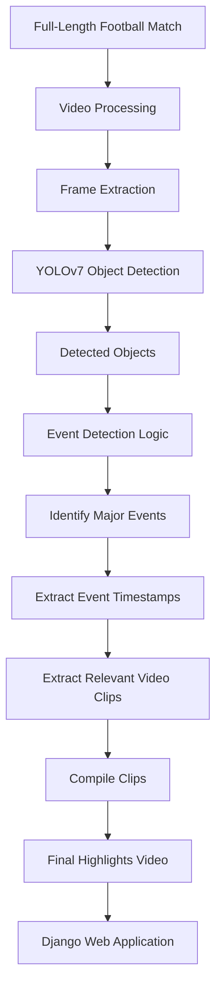

# DeepShot ⚽
### Automated Football Highlights Generation Using Deep Learning & Computer Vision

DeepShot is a computer vision-based application that automatically generates football (soccer) match highlights from full-length match recordings. By leveraging Deep Learning and Computer Vision techniques, the system identifies significant events during a match, extracts the corresponding video segments, and combines them into a single highlights video.

Unlike conventional sports highlight-generation systems that primarily rely on audio signals, DeepShot focuses on **visual information extracted directly from match footage**. This allows the system to identify important events through object detection and visual analysis rather than depending on commentary, crowd reactions, or audio cues.

---

## 📌 Table of Contents

- [Project Overview](#-project-overview)
- [Problem Statement](#-problem-statement)
- [Project Objectives](#-project-objectives)
- [Key Features](#-key-features)
- [Technologies Used](#-technologies-used)
- [System Architecture](#-system-architecture)
- [How It Works](#-how-it-works)
- [Dataset Preparation](#-dataset-preparation)
- [Deep Learning Model](#-deep-learning-model)
- [Event Detection Methodology](#-event-detection-methodology)
- [Highlight Generation](#-highlight-generation)
- [Web Application](#-web-application)
- [Evaluation and Results](#-evaluation-and-results)
- [Deployment and MLOps](#-deployment-and-mlops)
- [Repository Structure](#-repository-structure)
- [Limitations](#-limitations)
- [Future Improvements](#-future-improvements)
- [Contributors](#-contributors)
- [Acknowledgements](#-acknowledgements)

---

## 🎯 Project Overview

Watching an entire football match can be time-consuming, particularly for viewers who are interested primarily in the most important moments. Traditionally, highlights are created manually by video editors who review the entire match, identify significant events, extract the relevant clips, and compile them into a highlights video.

DeepShot aims to automate this process.

The system accepts a full-length football match as input and uses Deep Learning and Computer Vision techniques to detect important events, including:

- Goals
- Red cards
- Yellow cards
- Near misses (when the ball approaches or passes close to the goalpost)

Once an event is detected, its timestamp is recorded. The system then extracts the relevant video segment around that timestamp and combines all extracted segments into a single highlights video.

The final output is an automatically generated video containing the major events of the match.

## ❗ Problem Statement

Football matches typically last approximately 90 minutes. Although many viewers enjoy watching the most significant moments, they may not always have the time to watch an entire match.

Official highlight videos are generally produced manually. This requires editors to review the match, identify important events, extract the corresponding footage, and edit the clips together. The process is time-consuming and requires considerable manual effort.

Existing automated approaches may rely on audio signals, such as commentator reactions and crowd noise, to identify important events. However, audio-based approaches can produce inaccurate results because crowd reactions, advertisements, commentary, and other background sounds do not necessarily correspond to actual match events.

DeepShot addresses this problem by adopting a **video-based approach to automated sports highlight generation**, using visual information and object detection to identify important events.

## 🎯 Project Objectives

The primary objectives of DeepShot were:

1. Accept a full-length football match as input.
2. Identify significant events using Deep Learning and Computer Vision.
3. Detect relevant objects within match footage.
4. Identify goals, cards, and near misses.
5. Record the timestamps at which significant events occur.
6. Extract relevant video clips around detected events.
7. Combine the extracted clips into a single highlights video.
8. Provide a web-based interface for demonstrating and accessing the generated highlights.

## ✨ Key Features

| Feature | Description |
|---|---|
| Video-based event detection | Identifies significant events using visual information rather than relying on audio |
| Object detection | Uses a YOLO-based deep learning model to detect relevant objects |
| Goal detection | Uses detected objects and their spatial relationships to identify potential goal events |
| Card detection | Identifies red and yellow card-related events |
| Near-miss detection | Identifies potential near misses involving the ball and goalpost |
| Timestamp extraction | Records the time at which important events are detected |
| Automatic clip extraction | Extracts relevant footage around detected events |
| Highlight compilation | Combines individual clips into a single highlights video |
| Web application | Provides a web-based demonstration interface |

## 🛠 Technologies Used

The project incorporated the following technologies and tools:

| Technology | Purpose |
|---|---|
| Python | Core programming language |
| YOLOv7 | Deep Learning-based object detection |
| Deep Learning | Object detection and visual event analysis |
| Computer Vision | Visual analysis and event-detection logic |
| LabelImg | Manual image annotation and dataset preparation |
| CVAT | Data annotation |
| Kdenlive | Video trimming and preparation |
| Django | Web application development |
| Docker | Application containerization |
| AWS | Cloud hosting and deployment |

## 🏗 System Architecture

DeepShot follows a pipeline-based architecture in which the input match video is processed through several stages before the final highlights video is generated.

The overall workflow consists of:

1. Video Input
2. Video Processing and Frame Extraction
3. Object Detection using YOLOv7
4. Visual Event Detection
5. Timestamp Extraction
6. Video Segment Extraction
7. Highlight Compilation
8. Output and Web Application

### High-Level Workflow



## ⚙️ How It Works

### 1. Video Input and Processing

The system takes a full-length football match recording as input.

The video is processed and broken down into smaller segments and individual frames to facilitate visual analysis.

Frame extraction allows the object detection model to examine the match footage and identify relevant objects throughout the video.

### 2. Object Detection

The extracted frames are passed through a YOLO-based object detection model.

The model is trained to identify objects relevant to football events, including:

- Football
- Goalposts
- Red cards
- Yellow cards
- Other relevant visual objects

The model produces object detections that are subsequently used by the event-detection logic.

### 3. Event Detection

Object detection alone is not sufficient to identify a football event. The detected objects must be interpreted in the context of the match.

DeepShot incorporates additional logic that examines detected objects and their spatial relationships to identify potential events.

For example, the relative positions of the ball and goalpost can be used as part of the logic for identifying a potential goal.

Similarly, the detection of red and yellow cards can be used to identify card-related events.

### 4. Timestamp Extraction

Whenever a significant event is identified, the corresponding timestamp is recorded.

These timestamps represent the moments in the original match footage where relevant events occurred.

### 5. Video Clip Extraction

After identifying the timestamps, the system extracts the corresponding video segments.

The implementation was designed to capture footage around the detected event, including approximately 15 seconds before and after the event frame.

This ensures that the generated highlights contain relevant context rather than only the exact frame in which an event was detected.

### 6. Highlight Compilation

All extracted video segments are combined into a single video.

The resulting highlights video contains the significant events detected throughout the original match.

The final duration depends on the number of events identified.

## 🗂 Dataset Preparation

A major component of the project involved collecting and preparing a custom dataset for object detection.

Since readily available datasets did not adequately address the specific requirements of the project, football match footage was collected and manually annotated.

Approximately 25 football matches were collected during the initial data collection phase.

### Data Collection

Football match footage was collected from online sources, including:

- YourSoccerDose
- SoccerCatch
- Roboflow Universe

### Data Preparation Pipeline

The dataset preparation process involved:

1. Collecting full-length football match recordings.
2. Trimming and extracting relevant video segments using Kdenlive.
3. Extracting individual frames from the videos.
4. Identifying frames containing relevant objects and events.
5. Manually annotating the images using LabelImg and CVAT.
6. Preparing annotations in the YOLO-compatible format.
7. Organizing the dataset for model training.

### Annotation

The images were manually labelled to identify objects relevant to the project's event-detection requirements.

The annotation process included identifying objects such as:

- Footballs
- Goalposts
- Red cards
- Yellow cards

The resulting annotations were used to train the object detection model.

## 🧠 Deep Learning Model

DeepShot uses the YOLO (You Only Look Once) family of object detection models, with YOLOv7 being a key model used during development.

YOLO is a single-stage object detection approach that predicts object locations and their corresponding classes directly from images.

### Model Development Process

The model development process involved:

1. Preparing the custom annotated dataset.
2. Experimenting with different Machine Learning and Deep Learning models.
3. Evaluating pre-trained models against the project's requirements.
4. Training neural network models using the collected dataset.
5. Testing and validating model predictions.
6. Tuning hyperparameters to improve detection performance.
7. Integrating the object detection results into the event-detection pipeline.

### Why YOLO?

YOLO was selected as an object detection approach because it allows multiple objects to be identified within an image in a single detection pass.

This makes it suitable for processing video frames where multiple relevant objects may appear simultaneously.

## 🔍 Event Detection Methodology

The project focuses on identifying three categories of major football events.

### 1. Goals

Goals are identified using visual information obtained from the object detection model.

The event-detection logic considers the detected football and goalpost, including their relative spatial positions, to identify potential goal events.

### 2. Red and Yellow Cards

The system uses object detection to identify red and yellow cards within the match footage.

The detection results are used by the event-detection pipeline to identify potential card-related events.

### 3. Near Misses

Near misses involve situations where the football approaches or passes close to the goalpost without resulting in a goal.

The system uses the detected ball and goalpost information to identify potential near-miss events.

These event-detection mechanisms combine deep learning predictions with additional computer vision logic to identify significant moments.

## 🌐 Web Application

A web-based application was developed using Django to demonstrate the functionality of DeepShot.

The application provides an interface for interacting with the system and accessing generated football highlights.

The intended application workflow includes:

- Administrative sign-in.
- Uploading football match footage.
- Managing generated highlight videos.
- Updating or deleting highlight entries.
- Watching generated highlights.

The web application acts as the demonstration interface for the underlying Deep Learning and Computer Vision pipeline.

## 📊 Evaluation and Results

Since the project involved identifying events within continuous video footage, conventional classification accuracy alone was not considered sufficient for evaluation.

Instead, the system was evaluated using:

- True Positives (TP)
- False Positives (FP)
- False Negatives (FN)
- Precision
- Recall

### Evaluation Metrics

**Precision**

Measures how many of the events detected by the system were actually correct.

\[
Precision = \frac{TP}{TP+FP}
\]

**Recall**

Measures how many of the actual events were successfully detected by the system.

\[
Recall = \frac{TP}{TP+FN}
\]

### Experimental Results

The system was evaluated using 55 sample videos.

The following results were recorded in the project evaluation:

| Event | True Positives | False Positives | False Negatives | Precision | Recall |
|---|---:|---:|---:|---:|---:|
| Goals | 11 | 2 | 2 | 84.61% | 84.61% |
| Near Misses | 12 | 5 | 1 | 70.58% | 92.30% |
| Red Cards | 5 | 1 | 3 | 83.33% | 62.50% |
| Yellow Cards | 8 | 2 | 3 | 80.00% | 72.72% |

These results demonstrate the system's ability to identify different categories of significant football events, with varying precision and recall across event types.

The evaluation also helped identify areas where the object detection and event-detection logic could be improved.

## ☁️ Deployment and MLOps

In addition to the model development and application implementation, the project incorporated basic MLOps and deployment practices.

The deployment-related work included:

- Containerizing the application using Docker.
- Preparing the application for deployment.
- Hosting the project on Amazon Web Services (AWS).
- Performing error analysis to assess the system's performance.

These practices helped make the application more portable and provided experience with deploying a Deep Learning-based software system.

## 📁 Repository Structure

The repository contains the Jupyter notebooks used during different stages of experimentation and development.

The available notebooks include:

```text
FYP_DeepShot/
│
├── FYP2.ipynb
│   └── Main project experimentation and development
│
├── RedCardDetection.ipynb
│   └── Red card detection experiments
│
├── VideoToFrames.ipynb
│   └── Video-to-frame extraction experiments
│
├── MovingRenamingFiles.ipynb
│   └── Dataset file organization and management
│
└── README.md
    └── Project documentation
```

## ⚠️ Limitations

The project has several limitations:

- The system requires football match footage as input.
- Detection performance depends on the quality and diversity of the training dataset.
- Advertisements and non-match footage within videos can affect detection.
- Object detection errors can lead to incorrect event identification.
- The event-detection logic relies on visual cues and may not correctly interpret every possible match situation.
- The precision and recall vary across different event categories.

## 🚀 Future Improvements

Potential improvements to DeepShot include:

- Expanding the dataset with more diverse football matches and event examples.
- Improving object detection accuracy through additional training and experimentation.
- Incorporating temporal information to better understand events across consecutive frames.
- Improving the distinction between actual match events and visually similar situations.
- Extending the system to support other sports, such as cricket and hockey, with appropriate datasets and model adaptations.
- Improving the web application and deployment pipeline.
- Optimizing video processing to reduce overall highlight-generation time.

## 👨‍💻 Contributors

This project was developed as a Final Year Project at the National University of Computer and Emerging Sciences (FAST-NUCES), Islamabad, Pakistan, in 2023.

**Project Team:**

- Zohaib Bashir
- Zaafir Rizwan
- Shazil Ahmed

**Supervisors:**

- Dr. Akhtar Jamil
- Dr. Uzair Iqbal

## 🙏 Acknowledgements

We would like to thank our project supervisors for their guidance and support throughout the development of DeepShot.

We also acknowledge the research and open-source contributions of the Computer Vision and Deep Learning community, particularly the work surrounding YOLO and video-based sports event detection, which provided valuable references during the research and implementation phases.

## 📚 References

The project was informed by research in sports video analysis, action spotting, object detection, and temporal event localization.

Some of the key references include:

1. Vanderplaetse, B. and Dupont, S. (2020). *Improved Soccer Action Spotting using both Audio and Video Streams.*
2. Giancola, S. and Ghanem, B. (2021). *Temporally-Aware Feature Pooling for Action Spotting in Soccer Broadcasts.*
3. Deliège, A. et al. (2020). *SoccerNet-v2: A Dataset and Benchmarks for Holistic Understanding of Broadcast Soccer Videos.*
4. Wang, C.-Y. et al. (2022). *YOLOv7: Trainable Bag-of-Freebies Sets New State-of-the-Art for Real-Time Object Detectors.*
5. Simonyan, K. and Zisserman, A. (2014). *Two-Stream Convolutional Networks for Action Recognition in Videos.*

---

**DeepShot — Making Football Highlights Automatic, One Event at a Time.** ⚽
